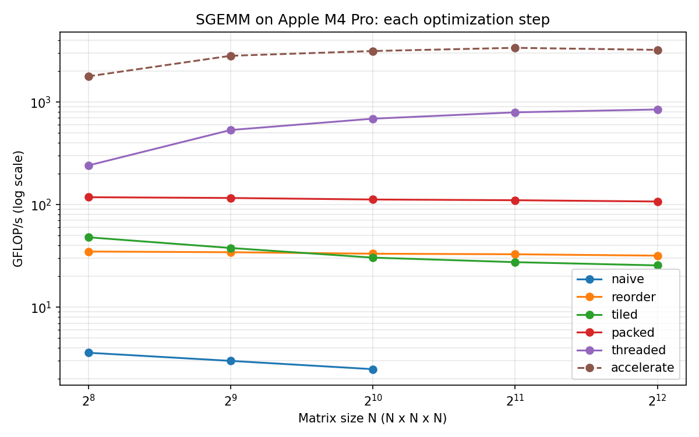

# fast-matmul

Single-precision matrix multiply (SGEMM) in C++, optimized one step at a time on an
Apple M4 Pro, from a textbook triple loop to a packed, register-blocked NEON kernel.
Every step is measured, and every kernel is checked against Apple Accelerate.



## Results (GFLOP/s, higher is better)

| N | naive | reorder | tiled | packed (1 core) | threaded (12 threads) | Accelerate |
|---:|---:|---:|---:|---:|---:|---:|
| 256  | 3.6 | 34.9 | 48.1 | 118.1 | 240.9 | 1781.7 |
| 512  | 3.0 | 34.4 | 37.8 | 116.1 | 534.0 | 2825.6 |
| 1024 | 2.5 | 33.2 | 30.4 | 112.2 | 688.6 | 3144.6 |
| 2048 | –   | 32.8 | 27.5 | 110.5 | 794.2 | 3378.5 |
| 4096 | –   | 31.8 | 25.6 | 107.3 | 846.8 | 3226.9 |

At N = 1024 the single-core packed kernel is **~45× faster than naive**, and the threaded
version is **~275× faster**.

## The steps and what each one taught me

| Version | Idea | Effect |
|---|---|---|
| `naive` | `i, j, k` loops | Reading a column of B jumps N floats each time, so nearly every access misses cache. |
| `reorder` | `i, k, j` loops | The inner loop now walks B and C contiguously, so the compiler auto-vectorizes it. **~13×**. |
| `tiled` | Cache blocking on top of `reorder` | Helped only at small N and was *slower* at large N. See below. |
| `packed` | GotoBLAS-style packing plus an 8×8 NEON micro-kernel | **~3.4× over `reorder`**. The 8×8 tile of C stays in 16 NEON registers for the whole K loop. |
| `threaded` | Split rows of C across threads | Scales to ~847 GFLOP/s. Each thread owns a band of rows, so no locks are needed. |

### Why tiling alone didn't help

I expected cache blocking to be the big win. It wasn't. In `reorder`/`tiled`, the inner loop
loads *and stores* a row of C for every single `k`. That memory traffic, not cache misses,
is the bottleneck: each fused multiply-add needs a load of B, a load of C and a store of C.
The fix was **register blocking**. The micro-kernel keeps an 8×8 block of C in registers
across the entire K loop, so each step does 16 FMAs for only 4 vector loads and no stores.
The shorter inner loops in `tiled` just added loop overhead.

### The micro-kernel

`src/packed.cpp`. For each `k`, it loads 8 values of A (a column of the panel) and 8 values
of B (a row), then computes their outer product into 16 accumulator registers with
`vfmaq_laneq_f32`. Packing A and B into contiguous panels beforehand means the kernel reads
two sequential streams, and zero-padding the edges means it never needs bounds checks.

Loop nest (outer → inner): `jc` (N, 1024) → `pc` (K, 256, pack B) → `ic` (M, 128, pack A)
→ `jr`, `ir` (8 × 8 micro-tiles). The B panel used by one micro-kernel call is
256 × 8 × 4 B = 8 KB, so it fits in L1.

### Why Accelerate is still ~4× faster

Accelerate uses the M4's dedicated matrix hardware (SME), not just the NEON vector units
used here. My single-core kernel reaches ~110 GFLOP/s, which is in the range of a P-core's
NEON FMA throughput, so further gains would need that matrix hardware rather than better
NEON code.

## Next steps

- Tune block sizes (MC/KC/NC) for each cache level, and try a 12×8 micro-kernel to use more of the 32 registers.
- Pack B once and share it across threads, instead of each thread packing its own copy.
- Pin threads to performance cores, and compare P-core-only and all-core scaling.
- Port the micro-kernel idea to a GPU (Triton) and to Tenstorrent's tt-metal.

## Build and run

```bash
cmake -S . -B build -DCMAKE_BUILD_TYPE=Release
cmake --build build -j
./build/test_correctness          # every kernel vs Accelerate on 8 odd shapes
./build/bench results.csv         # prints the table above
python3 scripts/plot.py results.csv
```

Requires a C++17 compiler. On Apple Silicon it uses NEON and Accelerate. Elsewhere it falls
back to a scalar micro-kernel and needs a CBLAS library.
